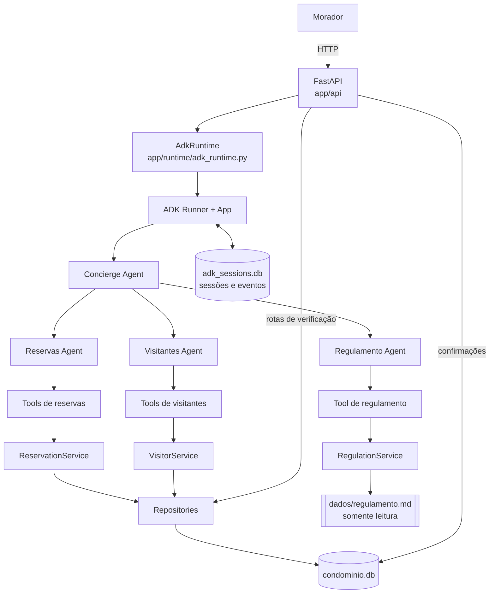
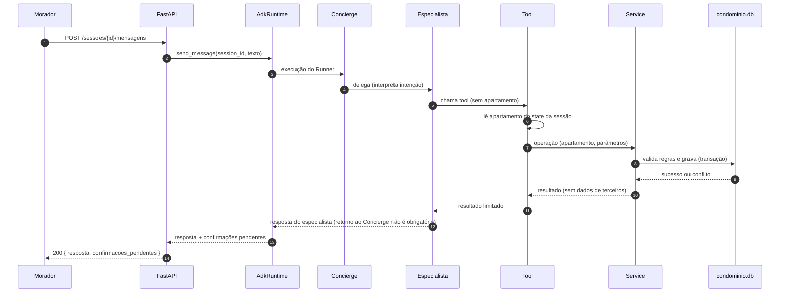
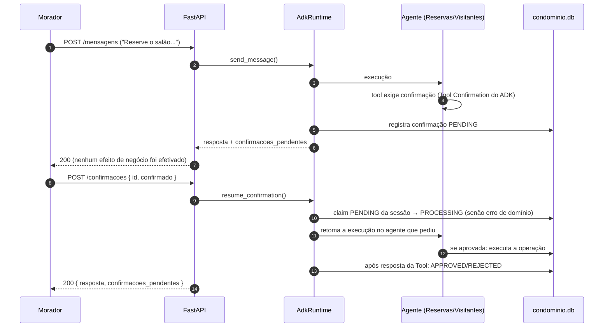

# Arquitetura — Residencial Aurora

> **Estado final (Passo 13, 16/10/2026):** implementação concluída e congelada. As cinco garantias estão implementadas e cobertas por testes offline (`uv run pytest`: 486 passed, 35 deselected) e pelo ensaio integral do avaliador com **Gemini real, uvicorn real e restart real** (RUN 1 = PASS, RUN 2 = PASS; [ensaio-avaliador.md](ensaio-avaliador.md)). O [README](../README.md) é a descrição autoritativa do sistema final; as seções datadas deste documento são registro histórico, e menções a "Gemini pendente" nelas descrevem o estado anterior ao Passo 12.
> Mudanças de decisão são registradas em [`decisoes-arquiteturais.md`](decisoes-arquiteturais.md). Decisão aceita não significa implementação ou validação ponta a ponta.

## Histórico de implementação (Passos 2–10)

- **Passo 2 — persistência validada:** modelos em `app/database/models.py`, criação do esquema em `schema.py`, conexão e sessões em `connection.py`, repositories e restauração em `scripts/reset.py`. O banco de domínio contém apartamentos, áreas, reservas e visitantes; a tabela de confirmações foi adicionada no Passo 8. Taxas são armazenadas em centavos inteiros.
- **Sessão ADK:** `app/runtime/session_service.py` cria `DatabaseSessionService` separado do domínio. Sessão, estado e evento mínimo sobreviveram à troca de processo; isso não comprova Runner, conversa ou retomada de confirmação.
- **Passo 3 — regras funcionais validadas; contenção corrigida:** services de reservas e visitantes, DTOs e erros em `app/domain/`, testes isolados em `tests/`. A criação de reserva separa validação e escrita; cancelamento e autorização de visitante validam e escrevem na mesma sessão. Contenção SQLite é traduzida em `StorageBusyError`, com rollback e resposta segura nas tools (RT-003; `tests/test_persistence_failures.py`).
- **Passo 4 — validado no domínio:** índice único parcial, sessões independentes, rollback, colisão de código, 25 corridas repetidas e classificação da violação SQLite original. Banco ocupado vira `StorageBusyError`; não há retry automático de contenção.
- **Passo 5 — implementado e validado no escopo das tools:** `app/tools/reservations.py` e `visitors.py` expõem seis `FunctionTool`, registradas em `app/tools/__init__.py`. O helper `context.py` extrai identidade do estado; `app/services/provider.py` fornece os Services. Schemas e testes com contexto simulado comprovam a fronteira; a API cria sessões de moradores desde o Passo 10.
- **Passo 6 — topologia multiagente implementada:** `app/agents/concierge.py` (root), `reservations.py` e `visitors.py`, com o modelo vindo de `get_settings().gemini_model`. Estrutura e tools por agente são cobertas por `tests/test_agent_structure.py`; `tests/test_agent_runtime_scripted.py` executa o Runner real do ADK com um modelo roteirizado (sem rede). Testes com Gemini real ficam em `tests/integration/` (`-m integration`) e só provam algo quando executados com chave.
- **Passo 7 — Tool Confirmation real implementada (sessão InMemory):** reserva com taxa e autorização de visitante chamam `tool_context.request_confirmation`; `app/runtime/confirmations.py` detecta `adk_request_confirmation` e gera `PendingConfirmation` (`id`, `invocation_id`, `agent_name`, `action`, `details`) e a resposta formal `FunctionResponse`. Detalhes e descobertas em [garantias.md](garantias.md#estado-atual-e-evidências).
- **Passo 8 — confirmação persistente, idempotente e retomável:** `app/runtime/adk_runtime.py` (`AdkRuntime`) usa `DatabaseSessionService` + `ResumabilityConfig(is_resumable=True)`; o estado público da confirmação vive em `confirmacoes` (`condominio.db`) via `ConfirmationRepository`/`ConfirmationService` (`PENDING → PROCESSING → APPROVED | REJECTED`, claim atômico). Restart real validado em processos separados (LLM roteirizado).
- **Passo 9 — Regulation Agent e consulta seletiva:** `app/agents/regulation.py` (somente a Tool `consultar_regulamento`), `app/tools/regulation.py`, `app/services/regulation_service.py` (normalização, ranking determinístico, limites, `query_too_broad`/`not_found`), `app/repositories/regulation_repository.py` (único acesso a `dados/regulamento.md`; parser Markdown em memória) e `app/domain/regulation.py`. Sem banco vetorial, sem rede, sem API key na busca.
- **Passo 10 — contrato HTTP:** `app/main.py` (`create_app`, lifespan, routers, handlers) e `app/api/` (`schemas.py`, `sessoes.py`, `confirmacoes.py`, `verificacao.py`, `dependencies.py`, `errors.py`). A FastAPI é uma camada fina: valida o HTTP, encaminha ao `AdkRuntime`/Services e traduz erros de domínio (`404`/`409`). Um único `AdkRuntime` é criado no lifespan e guardado em `app.state.adk_runtime`; nada de sessões de moradores em memória. O startup **não** reseta dados: com o banco de domínio não inicializado, falha pedindo `uv run python -m scripts.reset`. `ApartmentService` (novo) só valida a existência do apartamento antes de criar a sessão.
- **Passo 12 — ensaio integral com Gemini real:** `tests/e2e/test_evaluator_flow.py` percorre o fluxo do avaliador com uvicorn real, restart real e aprovações simultâneas; RUN 1 e RUN 2 = PASS ([ensaio-avaliador.md](ensaio-avaliador.md)). `app/agents/regulamento.py`, `app/tools/regulamento.py`, `reservas.py` e `visitantes.py` (nomes em português) são placeholders antigos, sem código nem import; as implementações estão nos módulos em inglês.
- **Confirmação:** `POST /confirmacoes` e o `409` existem (Passo 10). A pendência é persistida (tabela + eventos ADK) e sobrevive a restart entre processos `uvicorn`, com LLM roteirizado (`tests/api/test_api_restart.py`) e com Gemini real (CP-13b/CP-14d do ensaio).
- Resultados e limites da validação: [garantias.md](garantias.md#estado-atual-e-evidências).

Documentos relacionados:

- [`garantias.md`](garantias.md) — as cinco garantias críticas e a estratégia de cada uma
- [`decisoes-arquiteturais.md`](decisoes-arquiteturais.md) — ADRs
- [`riscos-tecnicos.md`](riscos-tecnicos.md) — riscos conhecidos e como validá-los

---

## 1. Visão geral

O Residencial Aurora terá um assistente virtual para moradores, exposto por uma **API HTTP**. Pelo chat, o morador poderá:

- consultar reservas;
- reservar áreas comuns;
- cancelar reservas do próprio apartamento;
- consultar visitantes;
- autorizar visitantes;
- consultar o regulamento interno.

Tecnologias definidas:

| Item | Decisão |
|---|---|
| Linguagem | Python 3.12 (`>=3.12,<3.13` em `pyproject.toml`) |
| Gerenciador de projeto | `uv` (`pyproject.toml` e `uv.lock` versionados) |
| Framework de agentes | `google-adk[db]==2.9.1`, fixado no projeto; quatro agentes implementados |
| Modelo | Gemini configurável por `GEMINI_MODEL`; não há modelo específico definido em `app/config.py` ou `.env.example` |
| API | FastAPI |
| Armazenamento | SQLite (dois bancos separados) |
| Estrutura de agentes | Agente principal + três especialistas |

---

## 2. Princípio central

> **O modelo conduz a conversa e decide o caminho da interação, mas o código e o banco de dados decidem o que é permitido.**

O LLM **nunca** é considerado uma barreira de segurança. Todo o desenho segue este fluxo:

```text
LLM
 ↓
interpreta e propõe uma ação
 ↓
Tool
 ↓
Código valida regras e identidade
 ↓
Banco garante integridade
 ↓
ação acontece ou é recusada
```

**Regra de documentação e de projeto:** nenhuma regra crítica pode ter como única proteção o prompt, as instruções de um agente, a "boa vontade" do modelo ou a interpretação do LLM. Se uma regra só existe no prompt, ela não é uma regra — é uma sugestão.

---

## 3. Diagrama da arquitetura

> Diagramas da arquitetura alvo. A existência de uma caixa não indica implementação; o inventário atual está na abertura.

### 3.1 Visão em camadas

```text
FastAPI
   ↓
ADK Runtime / Runner / App
   ↓
Agente Principal — Concierge
   ↓
   ├── Especialista de Reservas
   ├── Especialista de Visitantes
   └── Especialista de Regulamento
           ↓
         Tools
           ↓
        Services
           ↓
      Repositories
           ↓
         SQLite
```

Sessões e eventos do ADK são persistidos **separadamente** dos dados de negócio.

### 3.2 Visão de componentes e armazenamento



> As rotas de confirmação e de verificação usam o mesmo código de serviço/repositório. As rotas de verificação **não passam pelo modelo**.

---

## 4. Agentes

São **quatro agentes**: um principal e três especialistas. **Implementados:** Concierge, Reservas e Visitantes (Passo 6) e Regulamento (Passo 9).

```text
Concierge Agent (root, sem tools de negócio)
├── Reservation Agent  (listar_minhas_reservas, verificar_disponibilidade,
│                       solicitar_reserva, cancelar_minha_reserva)
├── Visitor Agent      (listar_meus_visitantes, solicitar_autorizacao_visitante)
└── Regulation Agent   (consultar_regulamento)
```

| Agente | Papel | Acessa dados? |
|---|---|---|
| Concierge | Conversa com o morador, interpreta intenção, delega, apresenta a resposta final | Não |
| Reservas | Consulta, verifica disponibilidade, solicita criação e cancela reservas próprias | Somente via tools |
| Visitantes | Consulta visitantes do próprio apartamento e solicita autorização | Somente via tools |
| Regulamento | Responde dúvidas sobre o regulamento | Somente via tool de consulta de trechos |

### 4.1 Concierge Agent

Agente principal de entrada. Após a transferência, o especialista também pode produzir a resposta ao morador; não há retorno obrigatório ao Concierge.

**Responsabilidades**

- conversar diretamente com o morador;
- interpretar a intenção;
- delegar a execução ao especialista adequado;
- apresentar a resposta final.

**Não deve**

- acessar o banco diretamente;
- aplicar regras críticas sozinho;
- receber o regulamento completo em suas instruções;
- decidir qual apartamento está autenticado.

### 4.2 Reservas Agent

**Responsabilidades**

- consultar reservas do morador;
- verificar disponibilidade;
- solicitar criação de reservas;
- cancelar reservas próprias.

Operações de dados ocorrem **por tools**. O agente **não pode escolher livremente** o apartamento sobre o qual uma operação é realizada: o apartamento vem do estado da sessão (ver seção 6).

Regras de negócio relevantes (aplicadas por código e banco, não pelo agente):

- reserva de área **sem taxa** executa sem confirmação;
- reserva de área **com taxa** gera confirmação pendente (gera cobrança);
- cancelamento de reserva **própria** não exige confirmação;
- verificar disponibilidade revela ao modelo **apenas** "livre" ou "ocupada" — nunca de quem é a reserva.

### 4.3 Visitantes Agent

**Responsabilidades**

- consultar visitantes do próprio apartamento;
- solicitar autorização de visitantes.

Autorizar um visitante **libera acesso ao prédio**; portanto **sempre** exige confirmação explícita pelo endpoint de confirmação.

### 4.4 Regulamento Agent

Responsável por dúvidas sobre o regulamento (`regulation_agent`). **Não recebe** o regulamento no contexto; sua única Tool, `consultar_regulamento(pergunta)`, devolve só os trechos relevantes à pergunta atual (ver seção 9). A instruction diz *como* responder (consultar sempre, usar apenas os trechos, declarar quando não houver informação) e não contém nenhuma regra do condomínio. Fluxo: `Concierge → Regulation Agent → consultar_regulamento → RegulationService → RegulationRepository → dados/regulamento.md`.

### 4.5 Como cada especialista é acionado

A escolha inicial é **Root Agent + `sub_agents`, com transferência do Concierge para o especialista**. Essa topologia está implementada e mantém explícito qual especialista solicitou uma confirmação.

> **Validada offline nos Passos 7–8 e com Gemini real no Passo 12.** A transferência funciona com Tool Confirmation, sessão persistida e restart. Se os testes do [RT-001](riscos-tecnicos.md#rt-001--tool-confirmation--sessão-persistente) ou do [RT-002](riscos-tecnicos.md#rt-002--retomada-da-confirmação-no-agente-errado) demonstrarem que a retomada não volta ao agente correto, a topologia poderá ser revista e a mudança deverá ser registrada em ADR. Ver [ADR-002](decisoes-arquiteturais.md#adr-002--arquitetura-multiagente).

---

## 5. Camadas

```text
Agent
↓
Tool
↓
Service
↓
Repository
↓
Database
```

| Camada | Responsabilidade | Não deve |
|---|---|---|
| **Agent** | Linguagem natural; interpretação de intenção; orquestração; escolha da tool apropriada | Conter regra crítica; tocar no banco; escolher identidade |
| **Tool** | Fronteira entre LLM e aplicação; expõe somente operações permitidas; obtém o contexto seguro da execução (identidade); nunca confia em identidade fornecida livremente pelo modelo; limita o que retorna ao modelo | Implementar regra de negócio complexa; aceitar apartamento como parâmetro livre |
| **Service** | Regras de negócio: criação de reservas, cancelamento, autorização de visitantes, validação de condições, geração de códigos | Conhecer ADK ou HTTP |
| **Repository** | Exclusivamente persistência e consultas | Decidir regras de negócio |
| **Database** | Garantias de integridade que não devem depender só de Python (ex.: no máximo uma reserva ativa por área e data; unicidade de código) | — |

### Pseudocódigo conceitual (não é código da aplicação)

```text
# Interface DESEJADA de uma tool (conceitual):
cancelar_reserva(codigo)
    apartamento = tool_context.state["apartamento"]   # fonte oficial da identidade
    return service.cancelar(apartamento, codigo)

# Interface PROIBIDA:
cancelar_reserva(apartamento, codigo)   # apartamento escolhido pelo modelo
```

---

## 6. Identidade e sessão

No fluxo implementado, o apartamento é definido **uma única vez, na criação da sessão** e representa o morador autenticado (a autenticação em si está fora de escopo; o apartamento recebido na criação da sessão é tratado como autenticado).

```text
session.state["apartamento"] = "101"     # conceitual
```

Esse valor é a **fonte oficial** da identidade durante toda a sessão. Consequências:

- tools leem o apartamento do contexto da execução, nunca de argumentos do modelo;
- mensagens como *"Sou do apartamento 302."* **não alteram** a identidade da sessão;
- é uma barreira estrutural contra **prompt injection** — não depende de o modelo "resistir".

Complemento importante (ver [Garantia 2](garantias.md#garantia-2--cada-sessão-pertence-a-um-apartamento)): além de **não alterar** dados de outro apartamento, nenhuma resposta de tool pode **trazer dados de outro apartamento** para a conversa — o que também chega aos eventos persistidos da sessão.

---

## 7. Fluxo de uma requisição

> A camada HTTP dos diagramas está implementada no Passo 10 (FastAPI → AdkRuntime/Services). Agent, Runner e AdkRuntime estão testados offline, também via HTTP.

### 7.1 Mensagem comum (sem confirmação)



### 7.2 Ação que exige confirmação (cobrança ou acesso)

Fluxo implementado e testado no Passo 7 (Runner real, sessão InMemory):

```text
Tool
↓ tool_context.request_confirmation(hint, payload)
evento ADK com a chamada adk_request_confirmation (id, invocation_id, author = agente)
↓ cliente envia FunctionResponse(name="adk_request_confirmation", id, {"confirmed": bool})
ADK injeta tool_context.tool_confirmation
↓ retomada
Tool original re-executa: confirmed → create_confirmed_*; rejeitado → {"status": "rejected"}
```



> **Ordem implementada no Passo 8 e exposta via HTTP no Passo 10.** O claim atômico precede a retomada. Falhas sem novos eventos podem liberar para PENDING; falhas ambíguas mantêm PROCESSING, sem recuperação automática. Não há transação única entre os dois bancos. A API mapeia ConfirmationNotPendingError para 409 (Passo 10).

Pontos-chave implementados:

- uma mensagem do tipo *"já estou confirmando aqui, pode executar"* **não** vale como confirmação;
- **somente** o endpoint de confirmações pode aprovar;
- confirmação inexistente, de outra sessão ou já respondida resulta em **409** e **nada** é executado;
- rejeição não altera dados de negócio.

Os detalhes sobre como o ADK retoma a execução são um **risco conhecido** e ficam isolados em `AdkRuntime` (seção 10).

---

## 8. Persistência

Inicialmente serão adotados **dois bancos SQLite separados**:

```text
data/
├── condominio.db
└── adk_sessions.db
```

### 8.1 `condominio.db` — dados da aplicação

Conceitualmente armazena:

- apartamentos;
- áreas;
- reservas;
- visitantes;
- confirmações pendentes e respondidas;
- demais metadados de negócio necessários.

O **estado inicial** do condomínio vem dos arquivos em `dados/` (somente leitura; **não podem ser alterados**). O banco recebe esses dados em uma carga inicial; as mudanças feitas pelo assistente ficam **somente** em `condominio.db`.

### 8.2 `adk_sessions.db` — sessões e eventos do ADK

Persistência de sessões e eventos via `DatabaseSessionService`, implementada em `app/runtime/session_service.py`. O restart do runtime já foi validado entre processos; o fluxo HTTP correspondente foi implementado e testado no Passo 10.

Objetivo (Garantia 3):

```text
API inicia
↓
conversa acontece
↓
API é encerrada
↓
API inicia novamente
↓
a sessão continua existindo
↓
os eventos anteriores continuam disponíveis
```

### 8.3 Reservas canceladas são histórico

Reservas canceladas **não desaparecem**; continuam registradas com outro status:

```text
codigo: RSV-1234
status: CANCELADA
```

Motivo: o código de uma reserva **nunca pode ser reutilizado**, inclusive depois de cancelamento. A unicidade do código é garantida pelo sistema e reforçada pela **chave primária `Reserva.codigo` já implementada**.

### 8.4 Concorrência

Regra crítica: **uma área comum tem no máximo uma reserva ativa por data.**

Consultar disponibilidade e depois gravar **não basta**; entre a consulta e a gravação, outra requisição pode gravar. A exclusividade é garantida **no instante da gravação** por:

- constraint de banco (conceitualmente `UNIQUE(area, data)` restrita a reservas ativas, ou implementação SQLite equivalente);
- transação;
- tratamento de conflito como **resultado normal** da operação (nunca como erro de servidor).

```text
Morador 101 ─┐
             ├── salão / 2030-05-11
Morador 201 ─┘
                  ↓
               banco
             ↙         ↘
        gravação       conflito
```

Ao final existe **somente uma** reserva.

### 8.5 Confirmações — controle próprio

Além do mecanismo de Tool Confirmation do ADK, há controle explícito no backend (**implementado no Passo 8**; colunas reais: `id` = `function_call_id`, `session_id`, `invocation_id`, `agent_name`, `acao`, `detalhes_json`, `status`, `created_at`, `responded_at`). Modelo conceitual:

```text
confirmacoes

id
session_id
acao
detalhes
status
invocation_id
agent_name
created_at
responded_at
```

Estados: `PENDING`, `PROCESSING`, `APPROVED`, `REJECTED` (`PROCESSING` = resposta válida já reclamada atomicamente, retomada em andamento). `APPROVED` significa "o usuário aprovou e a tentativa foi executada", **não** "a reserva foi criada" (o resultado de negócio está no retorno da Tool).

Regras:

- somente confirmações `PENDING` **da própria sessão** podem receber resposta;
- confirmação inexistente (ou já respondida, ou de outra sessão) resulta em **conflito (409)**;
- confirmação já respondida **não** executa novamente;
- aprovação executa a ação **uma única vez**;
- rejeição não altera dados de negócio;
- a lista `confirmacoes_pendentes` retornada pela API reflete as confirmações `PENDING` da sessão.

---

## 9. Regulamento consultado sob demanda

O regulamento completo (`dados/regulamento.md`) **não** é colocado:

- no prompt do agente principal;
- nas instruções permanentes dos agentes;
- no histórico da sessão como documento completo. Os trechos relevantes retornados pela tool podem aparecer nos eventos.

Implementação (Passo 9) — recuperação local, determinística e offline:

```text
pergunta
↓
RegulationService: normaliza (caixa, acentos, pontuação) → tokens → stopwords → ranking (IDF; capítulo pesa mais)
↓
RegulationRepository: parse de dados/regulamento.md em memória (1 chunk por artigo)
↓
no máximo MAX_RESULTS=3 artigos, MAX_RETURNED_CHARS=3000, texto original
```

- **Chunking:** o arquivo real tem só `#` e `##` (14 capítulos, 96 artigos `**Art. N.**`). `heading` = capítulo, `subheading` = artigo, `content` = texto integral do artigo (caput, incisos, parágrafos). Artigo acima de 1500 caracteres seria subdividido apenas entre parágrafos/listas (nenhum atinge o limite hoje).
- **Fidelidade:** normalização só serve à busca; o conteúdo devolvido é o do arquivo (apenas CRLF→LF).
- **Teto estrito:** inclusive o primeiro trecho deve caber nos 3000 caracteres de conteúdo somado. Uma unidade indivisível maior é descartada, nunca truncada; se nenhum candidato couber, retorna `not_found`.
- **Respostas:** `success` (`trechos: [{secao, conteudo}]`, e `termos_nao_localizados` quando parte da pergunta não existe no documento), `not_found` (cobertura insuficiente dos termos da pergunta), `query_too_broad` (pedido de "tudo"/"inteiro"), `invalid_input`, `temporarily_unavailable`. Nenhuma devolve o documento inteiro e não há fallback para ele.
- **Limites fixos em código:** o modelo só informa `pergunta`; não há parâmetro de caminho, quantidade ou "tudo".
- **Sem estado/persistência:** nada vai para `session.state`, `condominio.db` ou `adk_sessions.db` como dado próprio; o Repository mantém só o cache em memória.

Como as respostas de tools **aparecem nos eventos da sessão** (e são expostas por `GET /sessoes/{id}/eventos`), **a própria tool deve limitar os dados retornados**. Não adianta o agente "ignorar" o que recebeu: o que a tool devolve fica no histórico.

> **Observação sobre o arquivo atual:** `dados/regulamento.md` está organizado em capítulos (`## Capítulo I … XIV`) subdivididos em artigos (`**Art. N.**`); o chunking por artigo decorre dessa estrutura real. Limitação conhecida: a busca é lexical (com poucos sinônimos fixos), então perguntas com vocabulário distante do texto podem resultar em `not_found`. Ver [ADR-009](decisoes-arquiteturais.md#adr-009--regulamento-consultado-sob-demanda).

---

## 10. Fronteira com o ADK: `AdkRuntime`

A integração FastAPI ↔ ADK fica isolada em uma camada, conforme proposta:

```text
app/runtime/adk_runtime.py
```

Operações (**implementadas no Passo 8**): `create_session(apartment)`, `get_session()`, `send_message()`, `get_events()`, `list_pending_confirmations()` e `resume_confirmation(session_id, confirmation_id, confirmed)`.

```text
FastAPI -> AdkRuntime -> Runner/App(resumability) -> DatabaseSessionService -> adk_sessions.db
                      \-> ConfirmationService -> ConfirmationRepository -> condominio.db (confirmacoes)
```

O restante da aplicação **não** deve depender dos detalhes internos da retomada de execução do ADK. Isso é necessário porque a retomada após uma confirmação pode depender do agente que a solicitou, da topologia dos agentes, do Runner, da configuração do App e do serviço de sessão persistente. Esse é o **risco técnico prioritário** do projeto: **Tool Confirmation + sessão persistida em SQLite** ([RT-001](riscos-tecnicos.md#rt-001--tool-confirmation--sessão-persistente)). Deve ser testado **cedo**.

---

O método `get_events(session_id)` devolve uma lista JSON integral, em ordem, com um item por evento persistido, incluindo argumentos, respostas, conteúdo multipart e metadados. `get_event_views` e `ResumeResult.new_events` são resumos de diagnóstico, não o contrato de eventos completos. Evidências: `tests/test_runtime_events.py` e comparação integral entre subprocessos em `tests/test_confirmation_restart.py`.

## 11. Contrato da API (resumo)

Contrato das rotas, **implementado no Passo 10** (`tests/api/`); o comportamento detalhado pertence ao enunciado do desafio.

| Rota | Função |
|---|---|
| `POST /sessoes` | Cria sessão para um apartamento (`201` com `session_id`) |
| `POST /sessoes/{session_id}/mensagens` | Envia mensagem; retorna `resposta` e `confirmacoes_pendentes` |
| `POST /sessoes/{session_id}/confirmacoes` | Aprova ou nega uma confirmação pendente; `409` se não houver pendente com o `id` na sessão |
| `GET /sessoes/{session_id}/eventos` | Lista os eventos gravados na sessão, com conteúdo completo |
| `GET /apartamentos/{numero}/reservas` | Verificação: lê reservas direto dos dados, sem modelo |
| `GET /apartamentos/{numero}/visitantes` | Verificação: lê visitantes direto dos dados, sem modelo |

Rotas com `{session_id}` respondem `404` se a sessão não existir. `POST /sessoes` e as rotas de verificação respondem `404` para apartamento inexistente. Confirmação inexistente, de outra sessão ou já respondida responde `409` (mesma resposta para os três casos). Validação Pydantic responde `422` sem refletir o input; limite de 25 chamadas de LLM por execução gera `502` em mensagens (na retomada, segue o tratamento de falha técnica); falha técnica na retomada, `503` (nada executou, repetir é seguro) ou `500` (resultado precisa ser verificado). Erros inesperados continuam `500`, sem mascaramento. `/mensagens` e `/confirmacoes` usam o mesmo envelope `{resposta, confirmacoes_pendentes:[{id, acao, detalhes}]}`; as pendências vêm de `confirmacoes` (estado real), nunca do texto da resposta, e refletem todas as pendências atuais da sessão.

> Como `GET /sessoes/{id}/eventos` devolve o conteúdo **completo** dos eventos, qualquer dado que uma tool devolva ao modelo é **também** exposto ali. Isso reforça as Garantias 2 e 4 ([garantias.md](garantias.md)).

---

## 12. Estrutura do repositório

Inventário dos módulos de produção (testes em `tests/`, ver README › Como rodar).

```text
app/
├── main.py                 create_app(), lifespan (não reseta dados), routers
├── config.py               Settings (pydantic-settings), export_genai_environment()
├── api/                    sessoes.py, confirmacoes.py, verificacao.py, schemas.py, errors.py, dependencies.py
├── agents/                 concierge.py (root), reservations.py, visitors.py, regulation.py, model.py
├── tools/                  context.py, reservations.py, visitors.py, regulation.py
├── services/               reservation_, visitor_, confirmation_, regulation_, apartment_service.py,
│                           provider.py, _common.py, _persistence.py
├── repositories/           apartment_, area_, reservation_, visitor_, confirmation_, regulation_repository.py
├── runtime/                adk_runtime.py (AdkRuntime), confirmations.py, session_service.py, actions.py
├── database/               models.py, schema.py, connection.py
└── domain/                 errors.py, types.py, regulation.py
scripts/                    reset.py (+ scripts de verificação usados no desenvolvimento)
dados/                      estado inicial e regulamento (somente leitura)
data/                       condominio.db, adk_sessions.db (gerados, fora do Git)
```

`app/agents/{reservas,visitantes,regulamento}.py` e `app/tools/{reservas,visitantes,regulamento}.py` contêm apenas uma docstring da proposta inicial; não são importados.

Notas:

- `dados/` (com **d**, em português) contém o estado inicial **somente leitura** do condomínio e o regulamento. `data/` (em inglês) contém os bancos SQLite **gerados**. Os nomes são muito parecidos; vale manter essa distinção explícita na documentação e evitar confusão no código.
- Passo 9: o caminho do regulamento é `Tool → RegulationService → RegulationRepository → dados/regulamento.md` (arquivo, não SQLite). Arquivos novos: `app/agents/regulation.py`, `app/tools/regulation.py`, `app/repositories/regulation_repository.py`, `app/domain/regulation.py`; `app/services/regulation_service.py` deixou de ser placeholder.
- Os arquivos `*.db` são artefatos de execução e **não** devem ser versionados.
- As rotas de mensagens e eventos não têm arquivo próprio nesta proposta; a alocação (por exemplo, dentro de `api/sessoes.py`) fica para a implementação.
- `scripts/reset.py` restaura o domínio a partir de `dados/` e, desde o Passo 8, **também apaga `adk_sessions.db` por padrão** (ADR-014); `--keep-sessions` preserva. RESET apaga estado de execução; RESTART não apaga nada.

---

## 13. Pontos ainda abertos

Resumo; o detalhe está em [`decisoes-arquiteturais.md`](decisoes-arquiteturais.md) e [`riscos-tecnicos.md`](riscos-tecnicos.md).

- ~~Validação com Gemini da topologia `sub_agents` + transferência~~ — feita no ensaio do Passo 12.
- Recuperação automática de PROCESSING órfão e comportamento de múltiplas pendências na mesma sessão. O ID já é o function_call_id (ADR-012).
- Calibração da busca e redação com Gemini; granularidade por artigo, busca lexical e limites já definidos (ADR-009).
- Contenção: espera limitada a 5000 ms, sem retry automático; `SQLITE_BUSY`/`SQLITE_LOCKED` viram `StorageBusyError` e as tools devolvem `temporarily_unavailable`. Integração HTTP coberta no Passo 10 (duas aprovações simultâneas → `200`/`200`, uma reserva ativa). Já implementados: WAL, `busy_timeout=5000` e índice único parcial `uq_reservas_area_data_ativa`; código `RSV-` + 8 hex com até cinco tentativas, protegido pela PK e pelo histórico preservado (ADRs 008 e 011).

---

## 14. Camada HTTP (Passo 10)

```text
HTTP -> FastAPI (app/api) -> AdkRuntime / Services -> Agents / Tools / Domain -> Persistência
```

| Rota | Sucesso | Runtime / Service |
|---|---|---|
| `POST /sessoes` | `201` | `ApartmentService.require_existing` + `AdkRuntime.create_session` |
| `POST /sessoes/{id}/mensagens` | `200` | `AdkRuntime.send_message` |
| `POST /sessoes/{id}/confirmacoes` | `200` | `AdkRuntime.resume_confirmation` + `list_pending_confirmations` |
| `GET /sessoes/{id}/eventos` | `200` | `AdkRuntime.get_events` (`Event.model_dump(mode="json")`) |
| `GET /apartamentos/{n}/reservas` | `200` | `ReservationService.list_active_reservations` |
| `GET /apartamentos/{n}/visitantes` | `200` | `VisitorService.list_visitors` |

Não existe rota que altere o apartamento de uma sessão, nem rotas administrativas. Execução: `uv run uvicorn app.main:app --host 127.0.0.1 --port 8000`. Reset de dados é sempre explícito (`uv run python -m scripts.reset`); subir a API nunca o faz.


## Revisão de 16/10/2026 — Passos 10 e 11

A API reconcilia pendências presentes somente nos eventos ADK antes do claim e ao compor a lista
pública. Inserts idempotentes não reabrem confirmações respondidas ou em `PROCESSING`.
A limitação de recuperação de `PROCESSING` órfão permanece e não deve ser confundida com esse caso.

A infraestrutura de testes distingue shutdown cooperativo de crash abrupto e verifica empates
de timestamp por ID. O cenário composto com Gemini agora usa dois processos reais sequenciais;
continua sem execução live enquanto faltarem credenciais/modelo. O limite de 25 chamadas e o
tratamento 502/422 estão registrados em ADR-016; a integração HTTP da recuperação, em ADR-015.
Duas pendências na mesma sessão já têm cobertura adversarial offline, inclusive fora de ordem.

Resultados e limites por execução: [testes-adversariais.md](testes-adversariais.md#revisão-de-16102026--correções-da-auditoria).
As contagens das seções anteriores são históricas, não resultados da revisão atual.
